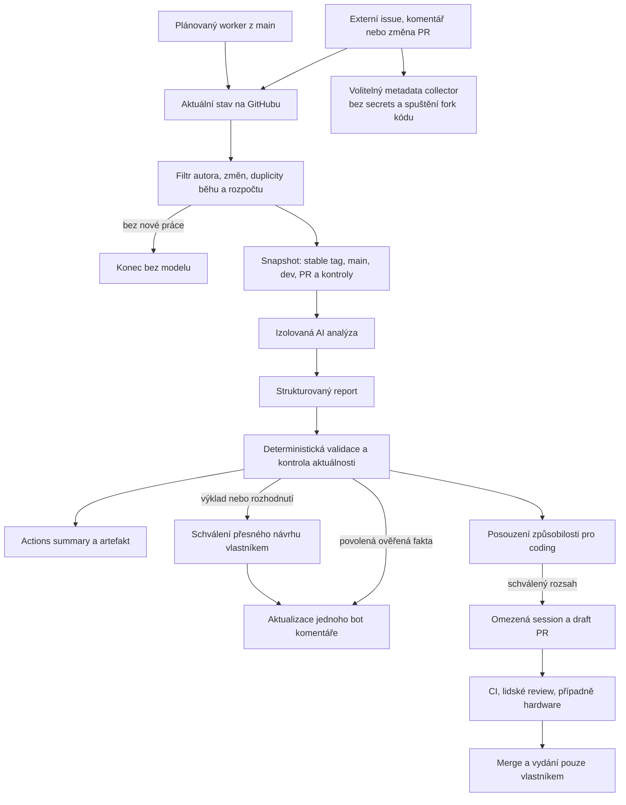
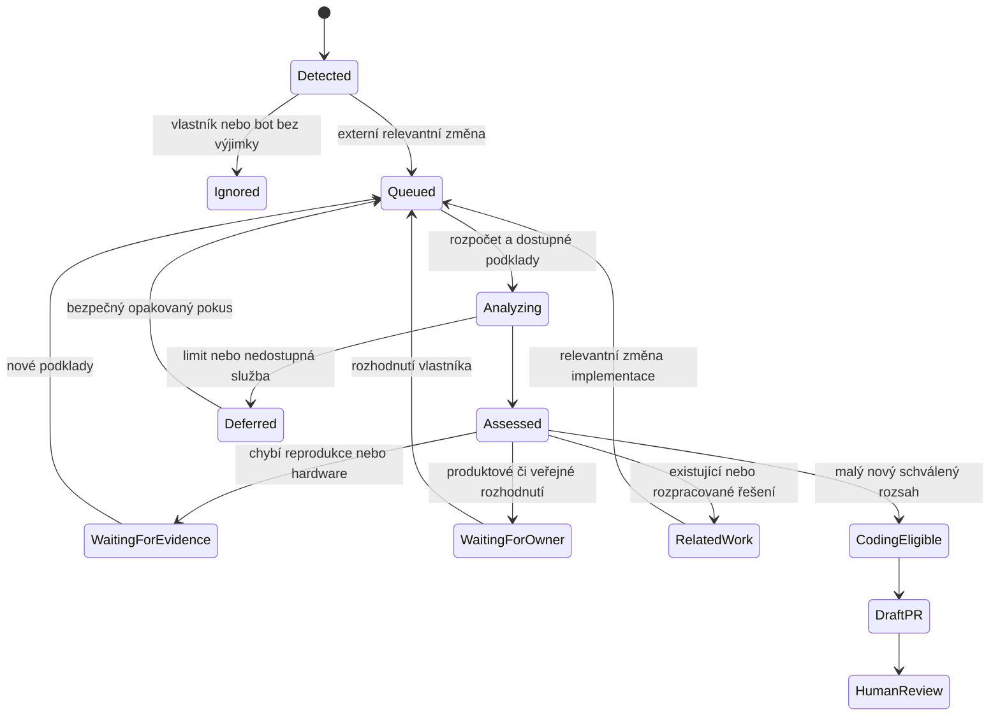
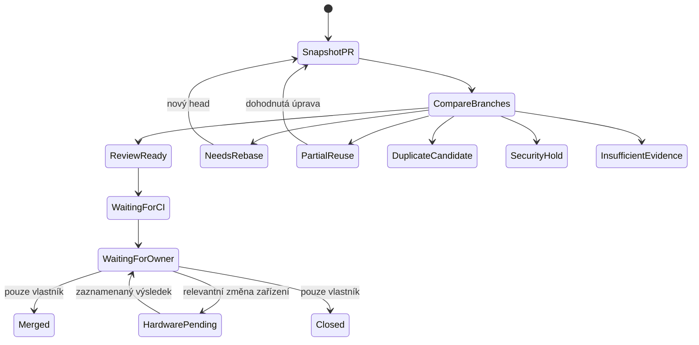
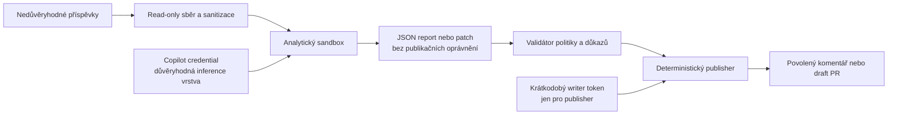

# Autonomní AI správce pro ha-ikea-bilresa

**Datum auditu a návrhu:** 13. listopadu 2026
**Repozitář:** [Vituhlos/ha-ikea-bilresa](https://github.com/Vituhlos/ha-ikea-bilresa)
**Autor návrhu:** Codex, AI asistent
**Stav:** Architektura a implementační plán. Nic z navržené nové automatizace není tímto dokumentem aktivováno.
**Jazyk:** Český plán pro vlastníka; budoucí veřejná komunikace asistenta bude anglicky.

Dokument zachycuje návrh z konverzace včetně diagramů, rozhodnutí, zdrojů a rozsahu prvního PR. Jeho uložení není schválením implementace, registrace App, přidání secrets, placeného provozu ani automatického zveřejňování. Zjištění popisují vzdálený repozitář v době auditu; lokální `main` byl starší. Před implementací znovu načíst aktuální SHA a nastavení, ale není potřeba znovu navrhovat celou architekturu.

Diagramy jsou zapsané v Mermaid a vykreslí se v náhledu Markdownu s podporou Mermaid, včetně GitHubu.

## Doporučení

Použít **GitHub Agentic Workflows (`github/gh-aw`) s Copilotem jako výpočetním backendem**, deterministickou kontrolou oprávnění a postupně přidanou identitou `bilresa-assistant[bot]`.

Automatická analýza má začínat bez zásahu vlastníka. Veřejné závazky, změny produktového chování, merge, vydání a nasazení zůstávají pod jeho kontrolou. První automatický provoz má používat plánovaný worker z důvěryhodného `main`, který přibližně každých 15 minut načítá nové a změněné externí příspěvky. Nevyžaduje server, Unraid runner ani běžící Codespace.

## Obsah

1. [Audit současného stavu](#1-audit-současného-stavu)
2. [Ověřené možnosti GitHubu](#2-ověřené-možnosti-githubu)
3. [Porovnání architektur](#3-porovnání-architektur)
4. [Události a rozhodovací tok](#4-události-a-rozhodovací-tok)
5. [Životní cykly issue a PR](#5-životní-cykly-issue-a-pr)
6. [Porovnávání větví a detekce duplicit](#6-porovnávání-větví-a-detekce-duplicit)
7. [Reálné příklady](#7-reálné-příklady)
8. [Identity a autentizace](#8-identity-a-autentizace)
9. [Veřejná komunikace a schvalování](#9-veřejná-komunikace-a-schvalování)
10. [Bezpečnostní model](#10-bezpečnostní-model)
11. [Stav, idempotence a zotavení](#11-stav-idempotence-a-zotavení)
12. [Omezený autonomní coding](#12-omezený-autonomní-coding)
13. [Modely, náklady a limity](#13-modely-náklady-a-limity)
14. [Navržená struktura souborů](#14-navržená-struktura-souborů)
15. [Testy a akceptační kritéria](#15-testy-a-akceptační-kritéria)
16. [Etapy, rollback a první PR](#16-etapy-rollback-a-první-pr)

## 1. Audit současného stavu

### Větve, vydání a příspěvky

| Oblast | Ověřený stav k datu auditu | Důsledek |
|---|---|---|
| Repozitář | Veřejný, výchozí větev `main` | Zachovat veřejnost. |
| Stabilní větev | `main`, HEAD `b2118a32c12afad465d68f1fc699694c0e8f1dfd` | Obsahuje i opravy dosud nevydané ve stabilní verzi. |
| Vývojová větev | `agent/panel-0.6.1`, HEAD `28c1035f30411fc105575fdd64a9ede19c623c44` | Vývojová řada 0.7. |
| Vydání | Poslední stabilní `v0.6.1`; nejnovější prerelease `v0.7.0-rc.7` | Větev, manifest a vydaná verze jsou samostatné skutečnosti. |
| Divergence | Vývoj má 171 vlastních commitů, `main` 71 | Nelze spoléhat jen na textový diff. |
| Merge-base | `6176206a1fb84ccf827d37aa813c1537ee5972cf` | Výchozí bod pro genealogické porovnání. |
| Otevřené příspěvky | 9 issues a jediný otevřený PR #71 | Malý provoz nepotřebuje distribuovaný systém. |

Role větví potvrzují [CONTRIBUTING.md na auditovaném main](https://github.com/Vituhlos/ha-ikea-bilresa/blob/b2118a32c12afad465d68f1fc699694c0e8f1dfd/CONTRIBUTING.md), [porovnání větví](https://github.com/Vituhlos/ha-ikea-bilresa/compare/main...agent/panel-0.6.1) a [vydání](https://github.com/Vituhlos/ha-ikea-bilresa/releases). Odkazy na pohyblivé větve a seznamy mohou později ukazovat novější stav.

### Ochrany větví

Oba rulesety jsou aktivní, bez bypass účtů. Vyžadují PR, vyřešené diskuse, aktuální základ větve a šest kontrol od GitHub Actions (integration ID `15368`):

- `Validate manifest (hassfest)`
- `Validate HACS`
- `Lint (ruff)`
- `Type check (mypy)`
- `Frontend checks`
- `Unit tests`

Počet povinných schválení je nula, což odpovídá jedinému správci. Rulesety blokují odstranění větve a force push. Konfigurace byla ověřena přes API; nebyl proveden pokus o zakázaný push nebo merge. Tento audit proto netvrdí, že otestoval všechny způsoby vynucení.

Zdroje: [ruleset main #26934594](https://github.com/Vituhlos/ha-ikea-bilresa/rules/26934594), [ruleset vývoje #26934615](https://github.com/Vituhlos/ha-ikea-bilresa/rules/26934615).

Actions mají výchozí token read-only a nesmějí schvalovat PR reviews. Povolené actions nejsou globálně omezené a není globálně vyžadováno připnutí SHA. Nová privilegovaná workflow proto musí mít vlastní immutable pins.

### Existující automatizace

| Součást | Zjištění | Doporučení |
|---|---|---|
| Běžné CI | PR bez omezení cílové větve; novější HA pouze plánovaně/ručně | Zachovat jako technickou autoritu. |
| CodeQL | Workflow na `main` omezuje PR kontroly na `main` | Neuvádět CodeQL jako automaticky ověřené pro vývoj. |
| CodeRabbit | Obě větve; draft PR automaticky vynechává | Zachovat; neopakovat kompletní review druhým botem. |
| Sourcery | Na #71 skutečně provedlo review | Zahrnout jeho nálezy. |
| Dependabot | Týdenní aktualizace; výjimky pro provázané HA testovací balíčky | Zachovat. |
| Compatibility watch | Již má úspěšné plánované běhy | Nevytvářet druhého hlídače kompatibility. |
| Devcontainer | Samostatný Linux smoke workflow | Použít pro vývoj; nepotřebuje trvalý Codespace. |
| Release | Prerelease vzniká po příslušném tagu | Agent nesmí vytvářet tagy. |
| Stale | `needs-info` → po 21 dnech stale → za dalších 14 dní zavření | Před automatickými odpověďmi upravit. |
| `/agent prepare` | Funkční ruční předání, bez modelu | Zachovat jako záložní cestu. |

CodeRabbit konfigurace se mezi větvemi liší: `main` má tichý profil a potlačené doprovodné výstupy, vývoj starší jednodušší konfiguraci. Nový asistent má soustředit práci na porovnání větví, související příspěvky, rozhodovací podklady a validační stav.

Zdrojové konfigurace: [workflows na auditovaném main](https://github.com/Vituhlos/ha-ikea-bilresa/tree/b2118a32c12afad465d68f1fc699694c0e8f1dfd/.github/workflows), [CodeRabbit](https://github.com/Vituhlos/ha-ikea-bilresa/blob/b2118a32c12afad465d68f1fc699694c0e8f1dfd/.coderabbit.yaml).

### Skutečný stav předchozích fází

Fáze 1 má provozní základ: PR #68 byl sloučen, existuje devcontainer, zaznamenané ověření Codespace a aktivní rulesety. Konfigurace ochrany není totéž jako provedený negativní test každého pravidla.

**Fáze 2A už není jen návrh.** [PR #69](https://github.com/Vituhlos/ha-ikea-bilresa/pull/69) byl sloučen 10. listopadu 2026. [Běh 42816664327](https://github.com/Vituhlos/ha-ikea-bilresa/actions/runs/42816664327) vytvořil [handoff komentář k #67](https://github.com/Vituhlos/ha-ikea-bilresa/issues/67#issuecomment-6767416430). Pozdější události od přispěvatele a botů byly přeskočeny.

`PROJECT_STATUS.md` a dokumenty `ai-development-automation.md` a `phase2-agent-handoff.md` přesto místy uvádějí „proposed/unmerged“. Asistent musí tyto rozpory hlásit, nikoli přebírat první statusový odstavec jako aktuální fakt. Handoff nevykonává AI, nezakládá coding session a není autonomním správcem.

Vývojové `AGENTS.md` vyžaduje schválení odpovědí přispěvatelům a přiznání skutečného AI autorství. Automatické zveřejňování potřebuje výslovně schválenou úzkou výjimku. [Vývojové instrukce](https://github.com/Vituhlos/ha-ikea-bilresa/blob/28c1035f30411fc105575fdd64a9ede19c623c44/AGENTS.md).

## 2. Ověřené možnosti GitHubu

| Možnost | Co je ověřené | Omezení |
|---|---|---|
| Copilot cloud/coding agent | Placené Copilot plány i veřejné repozitáře | Není sám o sobě automatickým triage systémem. |
| Custom agent profiles | Instrukce, specializace a nástroje | Nenahrazují spouštěče ani bezpečnostní izolaci. |
| Copilot Automations | Události, plánování a automatické úlohy | Pouze private/internal; pro tento projekt nepoužitelné. |
| `github/gh-aw` | AI workflow nad Actions, Copilot engine a kontrolované výstupy | Vyžaduje autentizaci, konfiguraci a provozní test. |
| Copilot assignment/task API | Programové spuštění úlohy | Uživatelská autentizace; installation token App nestačí. |
| GitHub App | Oddělená identita a oprávnění | Neobsahuje model, licenci ani výpočetní backend. |

Zdroje: [dostupnost cloud agenta](https://docs.github.com/en/copilot/how-tos/manage-your-account/manage-policies), [omezení Automations](https://docs.github.com/en/copilot/concepts/agent-capabilities/agent-powered-workflows-and-operations/about-automations), [agent API](https://docs.github.com/en/copilot/how-tos/use-copilot-agents/cloud-agent/use-cloud-agent-via-the-api), [autentizace gh-aw](https://github.github.io/gh-aw/reference/auth/).

Read-only GraphQL dotaz v repozitáři vrátil `copilot-swe-agent` mezi dostupnými assignees. To potvrzuje dostupnost přiřazení pro použitou identitu, nikoli provedený test spuštění nebo ověřenou zbývající kvótu.

Pro osobní Copilot Pro dokumentace gh-aw popisuje fine-grained PAT s účtovým oprávněním **Copilot Requests: Read**, uložený jako `COPILOT_GITHUB_TOKEN`. Organizační `copilot-requests: write` vyžaduje odpovídající organizační účtování; nelze je automaticky vztáhnout na osobní repozitář.

### Co skutečně ukazuje NSPanel-Easy

NSPanel-Easy výslovně uvádí, že kromě automatických reviews není nic spouštěno automaticky. `panel-easy-assistant[bot]` je správcova GitHub App, jejíž práci spouští správce. Je vhodným vzorem identity, nikoli důkazem autonomní triage architektury nebo bezplatného backendu. [Politika použití AI](https://edwardtfn.github.io/NSPanel-Easy/ai_usage.html).

## 3. Porovnání architektur

| Varianta | Automatická triage | Implementace | Náročnost a slabina | Verdikt |
|---|---|---|---|---|
| A — nativní Copilot + profily | Potřebuje další orchestraci | Dobrá podpora úloh a PR | Automations nepodporují veřejný repozitář | Doplňkový coding backend. |
| B — gh-aw + Copilot | Ano, nad Actions | Ano, omezené výstupy | Správa kompilovaných workflow a verzí | **Doporučené jádro.** |
| C — vlastní Actions + assignment API | Samotné přiřazení issue analýzu neřeší | Ano | Širší uživatelský token, vlastní řízení sessions | Volitelný adaptér. |
| D — vlastní App + Copilot | Podle backendu | Podle backendu | Klíč App, instalace a rotace | Pozdější publikační vrstva nad B. |

B odděluje analytickou fázi a zápisy, využije existující předplatné a nevyžaduje server. gh-aw samotné je bezplatné; inference a výpočetní prostředí se účtují samostatně. [Účtování](https://github.github.io/gh-aw/reference/billing/).

Výchozí verzí pilotu může být [gh-aw v1.2.2](https://github.com/github/gh-aw/releases/tag/v1.2.2), vydané 10. listopadu 2026. Připnout compiler i runtime/actions; Markdown a vygenerované `.lock.yml` musí projít review. Novější dokumentaci nelze bez kompilace považovat za záruku dostupnosti každého nastavení v připnuté verzi.

ChatGPT Plus ponechat pro současný ruční Codex handoff. **Nezahrnuje placené OpenAI API použití.** Claude Desktop nepovažovat za automaticky dostupný headless backend v Actions. [Vymezení Plus a API](https://help.openai.com/en/articles/6950777-what-is-chatgpt-plus).

## 4. Události a rozhodovací tok

### Doporučený počáteční automatický provoz

Plánovaný worker z důvěryhodného `main` přibližně každých 15 minut načte přes API nové nebo změněné externí příspěvky. Automatická analýza nezačíná až po jejich ručním prohlédnutí vlastníkem.

Tato cesta není závislá na schválení fork CI ani na přímém přijetí externího aktéra autorizační branou gh-aw. GitHub plánování může mít zpoždění; 15 minut není SLA. Při větší frontě respektovat limity a zpracovávat položky spravedlivě podle stáří a relevance.



### Události

| Zdroj | Události / změny |
|---|---|
| Issue | `opened`, `edited`, `reopened` |
| Komentář k issue | Nový nebo upravený relevantní příspěvek externího člověka |
| PR | `opened`, `synchronize`, `edited`, `reopened`, `ready_for_review` |
| CI/review | Aktualizace validačních údajů; zpravidla bez nové AI analýzy |
| Změna main/vývoje | Zneplatnění souvisejících závěrů a kontrola rozpracovaných úloh |

Filtrovat původního autora i aktuálního aktéra. Vlastník, účty typu Bot a známé automatizace jsou ve výchozím stavu vyloučené. Výjimku musí autorizovat vlastník. Nový věcný komentář externího člověka může znovu otevřít analýzu; vlastní stavové komentáře nikoli.

Volitelný metadata collector může později zachycovat události okamžitě pomocí obyčejných Actions s minimálními read oprávněními. Nemá inference secrets, nespouští fork kód a není autoritou: worker data načte znovu přes API. Systém nesmí záviset na doručení každého eventu nebo artefaktu.

Přímé zrychlení přes `workflow_run` přidat teprve po integračním testu externího autora, původu workflow, rolí a artefaktů. Nepoužívat přímé privilegované gh-aw `pull_request_target` s otevřením všem rolím; přísná konfigurace tuto kombinaci odmítá. Bezpečný fallback je plánovaný worker, nikoli oslabování kontrol. [Spouštěče gh-aw](https://github.github.io/gh-aw/reference/triggers/).

## 5. Životní cykly issue a PR

Interní stav zpracování není stav otevření/zavření na GitHubu. Asistent automaticky nezavírá legitimní hlášení.

### Issue



Klasifikace: `bug`, `feature`, `documentation`, `question`, `duplicate_candidate`, `other`. Samostatně evidovat stav realizace a důkazů. Podezření na duplicitu samo issue nezavírá.

### Pull request



Review může doporučit přijetí, revizi, rebase, částečné převzetí nebo zamítnutí. Doporučení není provedení akce. Neúspěšné CI a chybějící hardware jsou odlišné důvody čekání.

## 6. Porovnávání větví a detekce duplicit

Každá analýza zaznamená poslední stabilní tag a jeho commit, aktuální main, aktuální vývoj a u PR jeho přesný head/base.

1. Načíst úplný popis, relevantní komentáře, všechny stránky změněných souborů a související PR.
2. Zjistit merge-base a ancestrii.
3. Použít porovnání commitů a patch-id jako rychlou indicii cherry-picků.
4. Vyhledat změněné funkce, konstanty, konfigurační pole a jejich volající.
5. Porovnat vstupní podmínky a výsledné chování, nejen text.
6. Najít regresní testy a jejich očekávání.
7. Ověřit status, dokumentaci a vydání proti konkrétním SHA.
8. Rozlišit implementaci, plán, CI a fyzické ověření.

Přesunutí `_rotate_number()` do většího souboru neznamená duplicitu opravy. Shodný patch nemusí zachovat chování, pokud se změnil okolní datový model. Git diff z merge-base navíc nesmí být zaměněn za úplné porovnání současných stromů dvou divergujících větví.

| Výsledek | Nutný podklad |
|---|---|
| Již implementováno | Konkrétní kód a odpovídající chování; dostupné testy |
| Částečně implementováno | Výčet pokrytých a zbývajících podmínek |
| Aktivní vývoj | PR/větev s relevantní implementací |
| Plánováno | Schválený plán bez hotové implementace |
| Duplicitní příspěvek | Stejný rozsah chování již pokrytý jiným příspěvkem |
| Nová změna | Doložená mezera v prohledaném rozsahu |
| Konflikt s architekturou | Konkrétní porušený kontrakt |
| Neurčeno | Chybějící soubor, zkrácený diff, nejasné očekávání nebo API |

„Nenalezeno“ musí obsahovat rozsah hledání; neznamená automaticky „neexistuje“. U neúplného diffu či překročení limitu nesmí vzniknout úplný kladný verdikt. Nejistotu vyjadřovat konkrétními chybějícími důkazy, nikoli jen nepodloženým procentem jistoty.

Pro úsporu postačí index podle SHA, symbolů, PR a témat. Vektorová databáze není nutná. Velký `PROJECT_STATUS.md` indexovat po oddílech, zachovat odkazy na původní text; souhrn není jediným důkazem. Další WIP větve prohledat podle relevance a existence na GitHubu, nikoli podle starých jmen v historickém logu.

## 7. Reálné příklady

| Příklad | Ověřený závěr | Povolená další akce |
|---|---|---|
| #70: fade prvního zářezu | Není implementován na main ani vývoji | Návrh funkce pro vývoj; default rozhodne vlastník. |
| #9: Zigbee2MQTT skupiny | Oprava v obou větvích a RC; přesná sestava reportéra neověřena | Nevytvářet druhou opravu; čekat na relevantní důkaz. |
| #71: nulové meze | Platná nová oprava chyby v obou větvích | Lidské posouzení do main, pak samostatný přenos do vývoje. |

### Issue #70 — fade prvního zářezu

[Issue #70](https://github.com/Vituhlos/ha-ikea-bilresa/issues/70) požaduje fade i prvního zářezu a navrhuje zapnout jej jako default.

Ověřené chování `_smoothing_transition()`:

- Ve stabilním `v0.6.1` se samostatný zářez nevyhlazuje.
- Na současném main i vývoji dostávají další dávky téhož otáčení celý přechod.
- První samostatný zářez stále dostává `0.0`.
- Vývojové testy tuto vlastnost výslovně zachycují, včetně `test_a_single_notch_is_never_smoothed`.

[PR #14](https://github.com/Vituhlos/ha-ikea-bilresa/pull/14) řeší související problém, nikoli celý požadavek #70. [PR #31](https://github.com/Vituhlos/ha-ikea-bilresa/pull/31) je vysvětlení v dokumentaci. Zbývá rozhodnutí o nastavení, defaultu, starých bindingách, UI EN/CS a hardwarovém A/B testu. Asistent nesmí slíbit přesné napodobení přímého IKEA párování ani funkci znovu zaměnit s již existujícím fade následných dávek.

Kontrolované soubory: `binding.py` na obou auditovaných HEAD a tagu `v0.6.1`, odpovídající testy a dokumentace. Výsledek: nový požadavek pro vývoj, vyžaduje produktové rozhodnutí; žádný automatický coding změny defaultu.

### Issue #9 — Zigbee2MQTT brightness regression

Relevantní je merge `08200c570675c00d53276130177b64c5c8927922` z PR #14 a přenos do vývoje `a303ea3ae7b306ce11fe8df2a6282b6443813c27`. Oprava omezuje přebírání průběžných hlášení skupiny během otáčení a mění přechody následných dávek. Je v RC, nikoli v posledním stabilním `v0.6.1`.

Poslední komentář již reportéra žádá o ověření RC.6 a případně samostatných světel. Bez nových podkladů nemá vzniknout další podobná žádost. Multi-light binding je související alternativa, nikoli prokázaná oprava konkrétní Z2M sestavy.

Výsledek: implementace existuje, přesný hardware pending, issue zůstává otevřené. Současný `needs-info` nesmí vést k automatickému uzavření novým systémem; před publikováním upravit i starý stale workflow.

Zdroje: [issue a komentáře](https://github.com/Vituhlos/ha-ikea-bilresa/issues/9), [otevřený hardwarový bod](https://github.com/Vituhlos/ha-ikea-bilresa/blob/b2118a32c12afad465d68f1fc699694c0e8f1dfd/docs/HARDWARE_TEST.md).

### PR #71 — explicitní nulové numerické a klimatické meze

- Head `f44ddfd229189667849c9583b99b4e639e63e40b`, cíl main.
- Tři commity autora `Hinrixx3026`: reprodukční test `b8a1378`, oprava `fa92a9e`, dokumentace `f44ddfd`.
- Chybný vzor `_as_float(...) or default` je stále na obou větvích i stabilním tagu.
- Oprava rozlišuje `None` od skutečné nuly; nemění pozitivní fallback neplatného nulového kroku.
- Testy pokrývají numerické a klimatické meze, konkrétní reprodukci a chybějící hodnoty.
- Šest povinných kontrol na tomto headu prošlo; CodeQL také. Novější HA job v upstream PR byl **skipped**, nikoli passed.
- Opravená sestava nemá zaznamenaný fyzický test. Reprodukce původní chyby na zařízení není validací opravy.

Doporučení: přijmout příspěvek k dokončení lidského review; neměnit autorovu větev. Přenos do 0.7 zachová autorství a přizpůsobí okolí `_target_state()`. Nevytvářet konkurenční AI implementaci stejné opravy. Jde o device-facing změnu včetně klimatického setpointu, proto nespadá do počátečního automatického coding allowlistu.

Zdroje: [PR #71](https://github.com/Vituhlos/ha-ikea-bilresa/pull/71), [upstream CI](https://github.com/Vituhlos/ha-ikea-bilresa/actions/runs/43352963969).

## 8. Identity a autentizace

| Účel | Identita / credential | Rozsah |
|---|---|---|
| Čtení repozitáře | `GITHUB_TOKEN` | Contents, issues, PR, checks, actions read podle potřeby |
| Copilot inference | Samostatný fine-grained PAT | Účtové `Copilot Requests: Read`; bez repo write |
| Pilotní zveřejnění | `github-actions[bot]` | Jen potřebný zápis komentářů |
| Pozdější identita | Installation token `bilresa-assistant` App | Instalace pouze do tohoto repozitáře |
| Publikace coding návrhu | Oddělený writer token | Contents/PR write pouze v důvěryhodném publisheru |
| Nativní Copilot assignment | Samostatný uživatelský token | Jen při výslovném zavedení adaptéru |

Pro první App stačí metadata read a oprávnění pro issue/PR komentáře. Bez administration, secrets, workflows write a bez bypass pravidel. Webhook server není nutný, pokud spouštění zajišťují Actions. Dostupnost přesného jména App je třeba ověřit při registraci.

**Installation token a App user-to-server token nejsou zaměnitelné.** Agent API nepřijímá installation token. Dokumentace přiřazení issue uvádí u fine-grained PAT write přístup k Actions, contents, issues a PR. Tento širší token do triage nezavádět. [API autentizace](https://docs.github.com/en/copilot/how-tos/use-copilot-agents/cloud-agent/use-cloud-agent-via-the-api).

GitHub oprávnění neumějí dokonale vyjádřit „smí vytvořit PR, nikdy nesmí merge“. Writer proto musí být izolovaný deterministický program s povolenými operacemi, bez přístupu modelu k tokenu. Stejně tak oprávnění k issues může umožňovat více než komentář; omezit operace handlerem.



Šipka inference vyjadřuje zprostředkované volání modelu, nikoli předání PAT do sandboxu. Toto oddělení musí ověřit pilot, nestačí je nakreslit.

## 9. Veřejná komunikace a schvalování

### Automaticky publikovatelná fakta

Při zavádění mohou ven jen šablonová fakta ověřená programem:

- vyhodnocené větve a SHA;
- odkazy na související PR;
- stav konkrétní CI kontroly na konkrétním SHA;
- že v posouzených záznamech nebylo doloženo hardwarové ověření dané opravy.

Poslední bod neznamená, že žádný člověk nikdy hardware nezkoušel. Vyjadřuje hranici dostupných důkazů.

Výroky „je to duplicita“, „oprava problém vyřeší“, „tento PR přijmeme“, žádost o instalaci RC nebo změna očekávaného chování zůstávají schvalované. Model nemůže autorizovat vlastní text označením „faktický“.

### Struktura reportu

```text
Assessment
Evidence and related work
Branch comparison
Validation status
Risks
Proposed next action
Owner approval required
```

Interní JSON musí navíc obsahovat zdrojové SHA, čas, policy version, odkazy na důkazy, seznam nepřečtených nebo nedostupných podkladů a povolenou další akci. Stav implementace, Static, Unit, CI, Hardware a Released evidovat zvlášť.

Příklad anglického označení autorství:

> Automated AI assessment generated by GitHub Copilot for bilresa-assistant. Model: … . This assessment has not been reviewed by the maintainer.

Model doplnit ze skutečných metadat běhu. Netvrdit, že text napsal Claude nebo že jej správce schválil, pokud to není pravda. Při schválené odpovědi rozlišit generátora textu, publikující App a schvalujícího vlastníka.

Jeden status komentář na issue/PR. Aktualizovat pouze komentář s odpovídajícím markerem **a správnou identitou autora**. Nepřepisovat komentáře přispěvatele ani správce. Kosmetická změna nevede k publikaci. Nevytvářet generická poděkování, opakované dotazy nebo termínové sliby.

gh-aw podporuje nahrazení předchozího komentáře; aplikační kontroly cíle a autorství zachovat. [Safe outputs](https://github.github.io/gh-aw/reference/safe-outputs/).

Schválení věcné odpovědi navázat na hash přesného textu, posouzená SHA a čas platnosti. Po změně podkladů se návrh vrátí ke kontrole. V první fázi nepřidávat automatické APPROVE ani REQUEST_CHANGES review; používat report nebo COMMENT.

## 10. Bezpečnostní model

Všechny příchozí issue texty, komentáře, PR popisy, fork kód i externí obsah jsou nedůvěryhodné. Ani dřívější schválení přispěvatele není trvalým oprávněním spouštět jeho nový kód s credentials.

| Hrozba | Navržená ochrana |
|---|---|
| Prompt injection | Vstupy jsou data; nemění politiku, nástroje ani oprávnění. |
| Škodlivý fork | Triage jej nespouští. Testy jsou oddělené bez secrets a write tokenů. |
| Podvržené AGENTS, hooks nebo MCP | Z fork/headu se neaktivují; politika je z důvěryhodné revize. |
| Únik credentials | Copilot PAT mimo modelový sandbox; writer token až v následném jobu. |
| Exfiltrace přes povolenou doménu | Omezení konkrétních API operací a repozitáře; doména sama nestačí. |
| Škodlivé artefakty | JSON schéma, velikost, původ; nikdy je nespouštět. |
| Podvržené CI | Kontrola SHA, zdrojové App, kontextu a závěru. |
| Změna workflow/politiky | Automatický coding tyto cesty nesmí měnit. |
| Bot smyčka | Filtr autora i aktéra, vlastní markery, bez automatického svolávání reviewerů. |
| Opakované doručení | Fingerprint obsahu a kontrola existujícího výsledku. |
| Současné sessions | Sériová přijímací brána a kontrola rozpracovaných úloh. |
| Nekonečné opravy | Nejvýše jedna automatická opravná iterace. |
| Zastaralý výsledek | Před zápisem znovu ověřit head, base, stav a politiku. |
| Nečekané náklady | Limity položky, autora, dne a měsíce před modelem. |
| Vydávání se za přispěvatele | Vlastní bot identita a zachované commit autorství. |

Důvěryhodné setup kroky, publisher a compiler patří do bezpečnostní hranice. Read-only GitHub token sám nezaručuje absenci jiných credentials. [Architektura gh-aw](https://github.github.io/gh-aw/introduction/architecture/), [GitHub secure use](https://docs.github.com/en/actions/reference/security/secure-use).

Konkrétní pravidla:

- Žádná interpolace issue textu do shellu nebo JavaScript zdroje; vstupy parsovat jako data.
- Žádné automatické stahování libovolných URL z issue; externí odkazy vyžadují omezenou politiku.
- Žádný přístup k jiným soukromým repozitářům, domácí síti nebo Home Assistant credentials.
- Před odesláním modelu a veřejným výstupem odstraňovat citlivé identifikátory a secrets; veřejný původ textu není důvod k jejich opakovanému šíření.
- Analytické nástroje omezit na čtení tohoto repozitáře a povolených revizí; bez obecného shellu.
- Nedůvěryhodné testy mají samostatné prostředí bez inference tokenu; neprovádět je vedle modelového procesu s tajemstvím.
- Actions summary a artefakty veřejného repozitáře nepovažovat za soukromou interní komunikaci.

**Před automatickým publikováním vypnout automatické zavírání ve stale.yml.** Nestačí přestat přidávat `needs-info`: #9 jej již má. Změna musí chránit i existující issues. Později lze zavést samostatnou správcem řízenou housekeeping politiku.

## 11. Stav, idempotence a zotavení

### Dva různé klíče

Analytický fingerprint:

```text
repository_id + item_id + obsah relevantních vstupů
+ PR head/base SHA + main SHA + dev SHA + policy_version
```

Vyloučit vlastní bot komentáře a samotné `updated_at`, které může změnit bot.

Stabilní implementační klíč:

```text
issue_id + schválený rozsah + cílová větev
```

Posun main vyvolá přehodnocení, nikoli druhý coding PR. Před novou session vždy hledat existující úlohu a draft PR stejného rozsahu.

### Ukládaný stav

- fingerprint a přesné zdrojové revize;
- stav zpracování a důvody;
- ID komentáře, session a draft PR;
- schválení a jeho rozsah;
- rezervovaná a naměřená spotřeba;
- chybějící důkazy a následující krok.

Pro diagnostické potvrzení v Etapě I stačí historie Actions a malé validované artefakty. Nejde o autoritu měsíčního účetnictví. Před placenou inferencí v Etapě II je nutná trvalá transakční evidence s atomickou rezervací, důvěryhodnou rekonstrukcí a vyúčtováním podle [provozního kontraktu](autonomous-ai-maintainer-runbook.md#persistent-state-and-future-accounting-contract). Pozdější komentáře a PR jsou dohledatelné výstupy, nikoli účetní autorita. Cache pouze zrychluje, není autorizační autoritou. Reporty například 14 dní, malé účetní/stavové záznamy 90 dní; hlídat storage kvótu.

Při ztrátě záznamu načíst znovu GitHub a hledat existující výstup. Nejasná historie zakazuje nový coding pokus a další nevyúčtovanou spotřebu. Stav dodaný modelem nikdy nepřepisuje rozpočet nebo schválení.

### Souběh a obnova

Všechny placené vstupy používají společnou sériovou přijímací bránu. Actions concurrency není spolehlivá fronta všech událostí: čekající běh může být nahrazen. Proto se práce rekonstruuje z GitHubu a plánovaná reconciliation napravuje vynechané události. Nespouštět další sessions jen proto, že se předchozí běh opozdil.

Pro 429/5xx nejvýše dvě opakování čtecí operace s `Retry-After`. U 401/403 zastavit a uvést chybějící oprávnění. Při nejasném výsledku zápisu nejdřív hledat již vzniklý komentář nebo PR. Zrušený či nedoúčtovaný modelový pokus se účetně nepovažuje za bezplatný.

## 12. Omezený autonomní coding

Musí být splněno vše:

- jasná očekávaná změna a akceptační podmínky;
- ověřená absence hotového řešení nebo aktivního konkurenčního PR;
- jednoznačná cílová větev;
- přibližně nejvýše 5 souborů a 250 změněných řádků;
- žádná migrace, nová závislost ani změna veřejného kontraktu;
- nejvýše 30 minut a jedna opravná iterace;
- dostupný rozpočet a žádná jiná session stejného úkolu.

Počáteční automaticky způsobilé třídy: malé opravy dokumentace EN/CS a úzce vymezené doplnění testů. Testy nesmějí oslabovat pokrytí, přidávat skip/xfail nebo měnit CI podmínky.

**Vždy individuálně schvalovat** bindingy, časování, Matter dekódování, discovery, reconnect, climate setpointy, konfiguraci, závislosti, workflow a bezpečnostní politiku. Malý diff není automaticky malé riziko; #71 je příklad.

Výstup je draft PR na nové větvi například `codex/ai/issue-123-…`. Cíle jen `main` a `agent/panel-0.6.1`. Publisher ověří aktuální základ, úplný seznam změn včetně rename/delete, symlinky, chráněné cesty a povolený rozsah.

Cizí PR automat pouze posuzuje. Integrační větev nebo částečné převzetí vyžaduje schválení; zachovat původní commity či prokazatelnou atribuci a vztah k původnímu PR. Nepřepisovat cizí historii ani neposílat force push.

Review feedback není automatická instrukce. Vyhodnotit jej proti kódu a politice; smyčka je omezena na jednu opravnou iteraci, pak eskalace. Chybějící hardware se neopravuje dalším modelovým během.

Nativní Copilot assignment může později nahradit vlastní coding session. Zpočátku nezavádět oba způsoby zároveň. Merge, release, tag, deployment, protected-branch push a mazání větví nejsou nikdy autonomními akcemi tohoto návrhu.

## 13. Modely, náklady a limity

### Ověřené účtování a předpoklady

Aktuální měsíční Copilot Pro dokumentace uvádí 1 500 AI Credits: 1 000 základních a 500 proměnlivých flex kreditů; 1 kredit odpovídá 0,01 USD. Kvóta je společná s ostatním Copilot používáním vlastníka. Některá existující roční předplatná mohou stále používat starší requestový model. Skutečný billing účtu a zbývající kvóta nebyly ověřeny.

Zdroje: [individuální billing](https://docs.github.com/en/copilot/concepts/billing-and-usage/individuals/billing), [ceny a legacy režim](https://docs.github.com/en/copilot/reference/copilot-billing/models-and-pricing).

| Limit | Počáteční návrh |
|---|---:|
| Jedna issue analýza | 5 AIC |
| Jedna hlubší PR analýza | 50 AIC |
| Jedna schválená coding session | 150 AIC |
| Celý systém za den | 150 AIC |
| Celý systém za měsíc | 500 AIC |
| Nové analýzy za den | 5 |
| Stejná položka za den | 2; další změny sloučit |
| Současné placené sessions | 1 |
| Coding sessions za měsíc | Nejvýše 4, stále pod společným rozpočtem |

Plánovací odhad, nikoli naměřená cena: 30 issue analýz po 2 AIC, 8 PR analýz po 25 AIC a 2 coding sessions po 100 AIC = 460 AIC, spotřeba v hodnotě 4,60 USD. Zahrnout detekční kroky a opravy; skutečnou cenu ověřit pilotem. Nejde o slib dodatečné faktury: spotřeba může být pokryta dosud nevyužitou zahrnutou kvótou.

### Modelová strategie

- Jednoduchá klasifikace a shrnutí: levnější dostupný Copilot model.
- Složité porovnání chování a coding: silnější model.
- Konkrétní model ID připnout po ověření dostupnosti pro daný účet a engine.
- Při nedostupnosti se nesmí tiše přejít na dražší model.
- Žádné nové inference jen kvůli změně CI z pending na success.
- Omezit načítaný kontext na relevantní oddíly s možností řízeného doplnění.
- Při překročení podkladového limitu vrátit neúplné posouzení, nikoli vymyšlený závěr.

### Výpočetní prostředí

Standardní GitHub-hosted runners ve veřejném repozitáři mají bezplatný compute; artefakty, cache a větší runners posuzovat zvlášť. Codespaces nejsou potřeba. GitHub Pro má podle aktuální dokumentace 180 core-hours a 20 GB Codespaces storage, ale jde o oddělenou službu. Nové cloud sandboxy také nezaměňovat s bezplatným standardním public Actions runnerem.

Zdroje: [compute účtování](https://docs.github.com/en/billing/concepts/product-billing/cloud-and-local-sandboxes), [zahrnuté kvóty](https://docs.github.com/en/billing/reference/product-usage-included).

### Vynucení rozpočtu

Před modelovým během rezervovat maximum. Zrušený, běžící nebo nevyúčtovaný pokus počítat konzervativně; rerun může stát znovu. Neúplné účetnictví znamená zastavení. Přijímací brána musí zohlednit již běžící a nedoúčtované pokusy, nikoli jen úspěšné artefakty na konci.

Vedle limitů gh-aw musí být společná deterministická kontrola všech vstupů. Denní guardrail gh-aw se u některých dispatch cest vynechává; odhad AIC nemusí přesně odpovídat faktuře. [Cost management](https://github.github.io/gh-aw/reference/cost-management/).

Pro pilot navrhnout dodatečné placené použití 0 USD se zastavením po dosažení limitu. Automat může vyčerpat svou povolenou kvótu a zastavit, místo překvapivých doplatků. Hodnoty v této kapitole musí před aktivací odsouhlasit vlastník.

## 14. Navržená struktura souborů

Jde o budoucí cesty, nikoli automaticky vytvořené nebo aktivované součásti:

```text
.github/ai-maintainer/
  policy.json
  branches.json
  report.schema.json
  prompts/triage.md
  prompts/pr-analysis.md
  prompts/coding.md

.github/workflows/
  ai-maintainer-snapshot.yml
  ai-maintainer-triage.md
  ai-maintainer-triage.lock.yml
  ai-maintainer-publish.yml
  ai-maintainer-code.md
  ai-maintainer-code.lock.yml

tools/ai_maintainer/
  snapshot.mjs
  branch_evidence.mjs
  eligibility.mjs
  fingerprint.mjs
  budget.mjs
  validate_report.mjs
  publish.mjs

tests/ai_maintainer/
  *.test.mjs
  fixtures/

docs/architecture/
  autonomous-ai-maintainer.cs.md
  autonomous-ai-maintainer-runbook.md
```

Použít současný Node testovací ekosystém; nepřidávat další aplikační framework. Validace a práci s komentáři lze částečně převzít z `agent_handoff.mjs`, jeho ruční autorizační model ale zůstane oddělený.

`policy.json` určuje povolené akce, chráněné cesty, limity a nutná schválení. Prompt vysvětluje důvody, nesmí být jediným místem vynucení zákazu. Neověřené modelové tvrzení není vstupem pro automatické změny oprávnění nebo rozpočtu.

## 15. Testy a akceptační kritéria

| Syntetický scénář | Požadovaný výsledek |
|---|---|
| Funkce existuje pouze ve vývoji | Rozlišení vývoje a stable tagu; žádný nový coding úkol |
| Stejná oprava s jinými názvy a commity | Posouzení symbolů a chování |
| PR ze starého základu | Starý snapshot není aktuální implementace |
| Částečně duplicitní PR | Přesný výčet existujícího a nového rozsahu |
| Issue žádá ignorování pravidel a token | Žádná změna nástrojů, oprávnění ani únik |
| Podvržené AGENTS/hooks ve forku | Nesmějí se aktivovat |
| Opakované doručení/rerun | Nejvýše jeden odpovídající výstup |
| Nový commit během analýzy | Starý report se nezveřejní jako aktuální |
| Posun main během codingu | Přehodnocení stávající úlohy; žádný druhý PR |
| Bot upraví vlastní komentář | Žádná rekurzivní analýza |
| Chybějící API oprávnění | Přesná chyba; bez širšího token fallbacku |
| Limit nebo chybějící účetnictví | Model se nespustí |
| Podvržený marker v cizím komentáři | Cizí komentář se neupraví |
| CI passed, hardware nedoložen | Oddělené validační stavy |
| #9 již má needs-info | Upravená politika jej automaticky nezavře |

Akceptační brány:

1. Deterministické bezpečnostní testy bez modelu.
2. Kontrola YAML a kompilovaných gh-aw oprávnění.
3. API adaptéry s mockovanými odpověďmi, paginací, neúplnými daty a rate limitingem.
4. Adversariální modelové scénáře hodnocené strukturou a důkazy, ne shodou formulací.
5. Malý schválený provozní pilot.
6. Ověření, že analytický sandbox nevidí Copilot PAT ani writer credentials.
7. Ověření odděleného prostředí pro nedůvěryhodné testy.
8. Botem vytvořený draft PR skutečně získá požadované CI kontroly.
9. Kill switch zastaví inference i publikaci již připraveného výsledku.

Poslední CI brána je zásadní: zápisy přes `GITHUB_TOKEN` nemusí vyvolat navazující workflow stejně jako lidské nebo App zápisy. Coding nelze aktivovat s předpokladem, že CI určitě naskočí. [Safe outputs a CI](https://github.github.io/gh-aw/reference/safe-outputs-triggering-ci/).

Automatické testy tohoto správce nenahrazují `docs/HARDWARE_TEST.md`. V tomto návrhu nebyl spuštěn fork kód, nové workflow, AI pilot ani fyzický test.

## 16. Etapy, rollback a první PR

### Postup zavádění

| Etapa | Co zavést | Podmínka dokončení |
|---|---|---|
| I — read-only podklady | Snapshot, porovnání větví, schéma, fixture testy, ruční diagnostický běh | Správné podklady #70/#9/#71; bez veřejných zápisů a inference |
| II — AI pod dohledem | gh-aw, Copilot credential, limity, reporty; samostatně schvalovaný publisher | Kvalitní reporty, bez úniků, ověřená spotřeba a identita |
| III — automatická triage | Plánované externí příspěvky a povolené faktické aktualizace | Deduplikace, obnova, kill switch, upravená stale politika |
| IV — omezený coding | Schválené malé úlohy → nová větev → draft PR | Autorství, CI, limity oprav a lidská kontrola |

Před etapou III výslovně schválit politiku automatických odpovědí. Před etapou IV úzkou autorizaci vytváření větví a draft PR; současné AGENTS to bez pokynu zakazuje. Samotné uložení návrhu tyto autorizace neposkytuje.

### Kill switch a rollback

```text
AI_MAINTAINER_ENABLED=false
AI_PUBLIC_RESPONSES_ENABLED=false
AI_CODING_ENABLED=false
```

Kontrolovat před inference i bezprostředně před zápisem. Při incidentu:

1. Vypnout příslušnou větev automatizace a zrušit běžící úlohy.
2. Při podezření na únik zneplatnit PAT nebo klíč App.
3. Zachovat auditní záznamy; odstranit případně zveřejněné tajemství a rotovat jej.
4. Ponechat běžné CI a ochrany větví.
5. Opravit konfiguraci přes lidsky řízený PR.
6. Znovu začít režimem bez veřejných zápisů.

Rollback automaticky nemaže cizí větve, PR ani historii. Návrat do ručního `/agent prepare` zůstává možný.

### Otevřená rozhodnutí a neověřené předpoklady

Vlastník při schválení implementace Etapy I potvrdil měsíční rozpočet **500 AIC**; Etapa I má spotřebu **0 AIC**. Dále musí samostatně rozhodnout rozsah automatických faktických zpráv, okamžik zavedení vlastní App a první třídy povoleného codingu.

Pilot musí ověřit billing režim účtu, skutečnou dostupnost zvolených modelů, izolaci credentials, podporu nastavení v připnutém compileru a navazující CI. Cesta přímého externího eventu přes gh-aw autorizaci není tímto auditem provozně ověřena; plánovaný worker je výchozí řešení.

Nezávislá read-only kontrola návrhu zdůraznila pět kontraktů, zapracovaných výše: autorizaci externích vstupů, rezervaci rozpočtu před modelem, stabilní identitu coding úlohy, přesnou hranici faktického komentáře a ochranu již existujícího #9 před stale uzavřením.

### Přesný rozsah nejbezpečnějšího prvního implementačního PR

**Název:** `chore(ai): add read-only contribution assessment snapshots`

- Opravit zastaralý záznam fáze 2A podle PR #69 a ověřeného běhu.
- Přidat mapu větví, schéma důkazů a read-only sběr podkladů.
- Přidat deterministické testy včetně snapshotů #70, #9 a #71.
- Přidat pouze ručně spouštěné diagnostické workflow s read oprávněními a výstupem do Actions.
- Zapojit testy do existujícího CI bez změny názvů povinných kontrol.
- Zdokumentovat bezpečnostní hranice a další aktivační brány.

**Mimo tento první PR:** AI credential, nová App, automatické komentáře, automatické spouštění analýzy, coding, úprava runtime integrace, release a deployment. Změnu stale politiky připravit jako samostatný malý krok před zapnutím veřejných odpovědí.

Výsledkem bude ověřitelný základ pro připojení gh-aw s Copilotem. Další session má začít kontrolou aktuálního vzdáleného stavu a implementací této jedné etapy, nikoli aktivací celého systému najednou.
